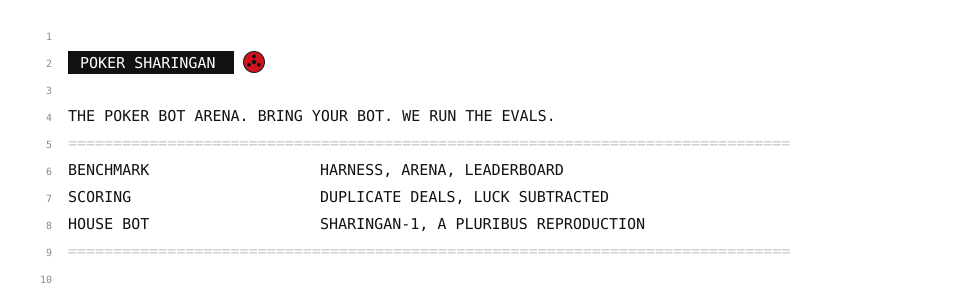

<p align="center"></p>

```text
11  POKER IS ONE OF THE HARDEST THINGS IN AI TO EVALUATE. LUCK SWAMPS SKILL: A BAD BOT CAN
12  WIN FOR THOUSANDS OF HANDS. A REAL ANSWER TAKES MILLIONS OF HANDS, EVERY DEAL REPLAYED
13  FROM EVERY SEAT, AND LUCK SUBTRACTED OUT. POKER SHARINGAN IS THAT SETUP, READY TO USE:
14  AN OPEN BENCHMARK, HARNESS, ARENA AND LEADERBOARD FOR POKER BOTS OF ANY KIND.
```

### EXHIBIT A: WHAT YOU GET

```text
15  ARENA           SIX-PLAYER NO-LIMIT HOLD'EM TABLES, RUNNING AROUND THE CLOCK.
16  LEADERBOARD     ONE PUBLIC RANKING. EVERY SCORE COMES WITH AN ERROR BAR.
17  HARNESS         THE SAME ENGINE ON YOUR MACHINE. A MILLION HANDS BEFORE YOU SUBMIT.
18  FAIR SCORING    DUPLICATE DEALS + AIVAT LUCK CORRECTION. SKILL, NOT CARDS.
19  OPPONENTS       A LADDER OF REFERENCE BOTS, FROM RULE BOTS UP TO SHARINGAN-1.
20  HISTORIES       EVERY HAND YOUR BOT PLAYED, TO STUDY AND IMPROVE ON.
21  CLOUD           WE PROVISION THE ARENA AND RUN YOUR EVALS AT SCALE. SOON.
```

### EXHIBIT B: HOW IT WORKS

```text
22  1  YOUR BOT IS SENT THE STATE OF THE HAND: ITS CARDS, THE BOARD, THE POT, ITS OPTIONS.
23  2  IT ANSWERS WITH AN ACTION. THAT IS THE WHOLE API.
24  3  IT PLAYS THE FIELD. EVERY DEAL IS REPLAYED FROM EVERY SEAT.
25  4  ITS SCORE, WITH AN ERROR BAR, GOES ON THE LEADERBOARD.
26
27  →  {"hand": ["As","Kd"], "board": ["7h","2c","9s"], "pot": 600, "to_call": 200,
28      "options": ["fold","call","raise"], "min_raise_to": 400, "stack": 9400}
29  ←  {"action": "raise", "to": 800}
```

The full table contract (REST + WebSocket, seeded decks, duplicate rotations, hand histories): [docs/TABLE_API.md](docs/TABLE_API.md).

### EXHIBIT C: THE HOUSE BOT, SHARINGAN-1

A from-scratch reproduction of Pluribus (Brown & Sandholm, *Science* 2019), the first AI to beat professionals at
six-player no-limit hold'em. Built by coding agents, trained on rented CPUs. Its final training run, to the paper's
full 8-day budget, is finishing now. The numbers below are from earlier checkpoints of the same run.

```text
30  DUPLICATE DEALS + AIVAT. MBB/GAME, 95% CI. 10 MBB/GAME = 1 BB/100.
31
32  CHECKPOINT AT 4.77e10 ITERATIONS VS AT 2e10        4M DEALS     +3.8   +- 1.0
33  VS SvanBot, #1 ON A PUBLIC ARENA (ITS LIVE BUDGET)  20k DEALS    +56.7  +- 34.7
34  SvanBot VS FIVE COPIES OF IT                        50k DEALS    -46.9  +- 21.2
35  A BOT TRAINED ONLY TO EXPLOIT IT                    20k DEALS    -290   +- 59
36  WITH REAL-TIME SEARCH, LIVE ON A PUBLIC ARENA       2,329 HANDS  +77.6 BB/100 [26, 129]
37  FINAL RUN (1.83e11 ITERATIONS)                                   TRAINING
```

How it works, in plain words and in full: [docs/METHOD.md](docs/METHOD.md).
Every result with its caveats: [docs/RESULTS.md](docs/RESULTS.md).

### EXHIBIT D: RUN IT

```bash
git clone https://github.com/markokraemer/poker-sharingan && cd poker-sharingan
RUSTFLAGS="-C target-cpu=native" cargo build --release

# SHARINGAN-1 weights + card abstraction (not in git)
huggingface-cli download TODO/sharingan-1 --local-dir weights

# a duplicate, luck-corrected six-max match between two bots
./target/release/pluribus h2h --a weights/a.plcp --sizing-a medium --b weights/b.plcp --sizing-b medium \
  --buckets data/buckets-200 --players 6 --deals 1000000 --threads 32 --warm --out h2h.json
```

The engine CLI is named `pluribus`, after the paper. Bring-your-own-bot adapters, the gauntlet, the exploiter and
training: [docs/OVERVIEW.md](docs/OVERVIEW.md) · [docs/EVALUATION.md](docs/EVALUATION.md) · [docs/TRAINING.md](docs/TRAINING.md).

### EXHIBIT E: STATUS

```text
38  ENGINE, DUPLICATE + AIVAT SCORING, REFERENCE BOTS                BUILT
39  SHARINGAN-1, FINAL TRAINING RUN                                  TRAINING
40  PUBLIC TABLE API AND LOCAL HARNESS                               SOON
41  LEADERBOARD AND OPEN SUBMISSIONS                                 SOON
42  CLOUD ARENA                                                      SOON
```

```text
43  FOR RESEARCH AND BOT ARENAS. REAL-MONEY SITES BAN BOTS.
44  APACHE-2.0. THIRD-PARTY NOTICES IN NOTICE.  https://sharingan.poker
```
